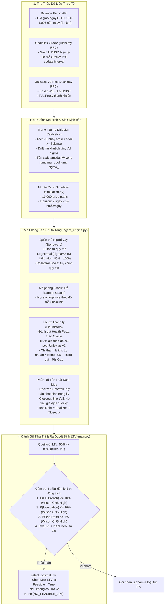

# CẨM NANG BẢO VỆ BÀI TẬP LỚN (DEFENSE GUIDE)
## Hệ Thống Tối Ưu Hóa LTV Cho Giao Thức Cho Vay Tiền Mã Hóa (Crypto Lending Risk Engine)

---

## 1. Sơ Đồ Thuật Toán & Kiến Trúc Tổng Thể

### 1.1 Luồng Xử Lý Đầu - Cuối (End-to-End Pipeline)

---

## 2. Biện Luận Bộ Giới Hạn Rủi Ro (Risk Appetite Rationale)

Hệ thống thẩm định ứng viên LTV dựa trên **4 ràng buộc đồng thời**:

| Chỉ Tiêu | Giới Hạn | Cơ Chế So Sánh | Cơ Sở Lý Luận & Ý Nghĩa Thực Tế |
| :--- | :---: | :---: | :--- |
| **P(HF Breach)** | $\le 10\%$ | Cận trên Wilson CI95 | **Đo lường sự bất ổn nội tại của người vay**, độc lập với hành vi của Liquidator. Khi phí gas mạng tăng vọt, liquidator có thể bỏ thanh lý (làm $P(\text{Liquidation})$ giảm giả tạo), nhưng borrower vẫn mất an toàn vốn. Giới hạn này ngăn chặn lỗ hổng đánh giá sai rủi ro khi gas cao. |
| **P(Liquidation)** | $\le 10\%$ | Cận trên Wilson CI95 | **Bảo vệ trải nghiệm người dùng & chi phí hệ sinh thái**. Tỷ lệ kịch bản có thanh lý thực thi phải dưới 10% trong vòng 7 ngày để tránh hoảng loạn thị trường và cascade liquidation (thanh lý hàng loạt). |
| **P(Bad Debt)** | $\le 1\%$ | Cận trên Wilson CI95 | **Bảo toàn khả năng thanh toán (Solvency)**. Giao thức lending coi nợ xấu là rủi ro hiện hữu đe dọa trực tiếp đến người gửi tiền (Suppliers). Xác suất danh mục rơi vào nợ xấu (kể cả thanh lý cưỡng bức cuối kỳ) không được vượt quá 1%. |
| **CVaR99 / Initial Debt** | $\le 2\%$ | Ước lượng điểm (Point Est.) | **Kiểm soát rủi ro đuôi cực đoan (Tail Risk)**. VaR chỉ cho biết ngưỡng, còn CVaR (Expected Shortfall) đo lường mức tổn thất trung bình trong 1% kịch bản tồi tệ nhất. Giới hạn 2% bảo đảm quỹ bảo hiểm (Safety Module) của giao thức đủ sức bù đắp tổn thất. |

### Tại sao bắt buộc dùng Cận Trên Wilson Score Interval 95%?
1. **Sai số lấy mẫu Monte Carlo**: Khi chạy số lượng mô phỏng hữu hạn ($N=10,000$ hoặc $N=1,500$), ước lượng điểm $\hat{p} = \frac{k}{N}$ có thể bằng $0\%$ chỉ vì "gặp may" trong lấy mẫu.
2. **Quy tắc an toàn**: Ngay cả khi $k=0$ biến cố xảy ra, cận trên Wilson là $\approx \frac{z^2}{N + z^2} > 0$. Với giới hạn $1\%$, nếu $N < 381$, cận trên Wilson luôn vượt quá $1\%$ ngay cả khi không có sự kiện nợ xấu nào! Điều này buộc hệ thống phải chạy số lượng mô phỏng đủ lớn ($N \ge 1,000$) thì mới được công nhận kết quả.

---

## 3. Tổng Hợp Kết Quả Thực Nghiệm Cốt Lõi

### 3.1 CP3: Kiểm định Merton Jump-Diffusion & Monte Carlo
1. **Tách cú nhảy âm (Left-tail separation)**:
   - Khi lọc bỏ các cú rơi đột ngột ($\ge 3\sigma$), drift khuếch tán $\mu_{\text{diffusion}}$ dịch lên đáng kể (+9.76% đến +85.25%), và độ biến động khuếch tán $\sigma$ giảm nhẹ (-1.03% đến -5.18%).
   - *Kết luận*: Tách riêng bước nhảy giúp drift mô hình phản ánh chuẩn xác giai đoạn thị trường bình thường, tránh tính trùng cú nhảy trong mô phỏng Monte Carlo.
2. **Bất định do số lượng cú nhảy hiếm**:
   - Dữ liệu 3 năm chỉ ghi nhận khoảng 10–15 cú crash $\ge 3\sigma$. Khoảng tin cậy Bootstrap 95% của $\lambda$ là $[0.0, 1.67]$ lần/năm.
   - *Kết luận*: Vì tham số đuôi hiếm có độ bất định cao, việc dùng cận trên Wilson CI và stress test là bắt buộc.
3. **Độ ổn định hạt giống (Seed Stability)**:
   - Thử nghiệm trên 5 seed ngẫu nhiên độc lập ($N=2,000$): Độ lệch chuẩn của xác suất thanh lý chỉ từ $0.8\%$ đến $2.8\%$. Cận trên Wilson CI95 tạo ra biên an toàn khoảng $1.2\% - 1.5\%$, giúp quyết định LTV hoàn toàn ổn định qua các seed.

### 3.2 CP4: Bảng Thử Nghiệm Ứng Suất (Stress Test Matrix)

#### Kịch bản 3.A: Sốc thị trường (Market Price Shocks)
- **Baseline (Bình thường: $\sigma=65\%, \mu=0.95\%$)**: Optimal LTV = **72%** (P(Liq) CI95 = 8.62%, P(Bad Debt) CI95 = 0.59%).
- **Bear Market (Gấu: $\sigma=85\%, \mu=-25\%$)**: Optimal LTV co về **64%**.
- **Black Swan (Đại khủng hoảng: $\sigma=110\%, \mu=-60\%$)**: Optimal LTV co về **54%** hoặc rơi vào **NO_FEASIBLE_LTV** tùy theo quy mô danh mục.

#### Kịch bản 3.B: Cạn kiệt thanh khoản & Phí Gas tăng vọt
- **Danh mục nhỏ ($25,000)**: Trượt giá đỉnh chỉ 0.26%, kênh thanh khoản trơ, nợ xấu không đáng kể ($1.52).
- **Danh mục lớn ($2.5M) + Pool sâu ($2M)**: Trượt giá đạt 7.39% (> bonus 5%), Closeout chiếm 85.0% nợ xấu.
- **Danh mục lớn ($2.5M) + Pool mỏng ($250k) + Gas $100**:
  - $P(\text{Liquidation})$ rớt về **0.00%** (vì thanh lý bị lỗ: phí gas $100 + trượt giá > 5% bonus).
  - Toàn bộ tổn thất chuyển thành **Closeout Shortfall ($642,355 - chiếm 100% Bad Debt)**.
  - *Ý nghĩa*: Minh chứng hoàn hảo hiện tượng đóng băng thanh lý (liquidation freeze) trong DeFi.

#### Kịch bản 3.C: Độ nhạy theo ngưỡng chấp nhận rủi ro & APR
- Ngưỡng $P(\text{Liq}) \le 2\% \rightarrow$ Optimal LTV = **66%**.
- Ngưỡng $P(\text{Liq}) \le 5\% \rightarrow$ Optimal LTV = **70%**.
- Ngưỡng $P(\text{Liq}) \le 10\% \rightarrow$ Optimal LTV = **72%** (ở APR 0%) và **72%** (ở APR 20%).
- Ngưỡng $P(\text{Liq}) \ge 15\% \rightarrow$ Chạm trần kiểm soát nợ xấu tại **73%**.

---

## 4. Bộ Câu Hỏi Phản Biện Bảo Vệ Thường Gặp (Q&A Defense)

### Câu 1: Tại sao mô hình lại cần mô phỏng tác tử (Agent-based) thay vì chỉ dùng công thức giải tích Black-Scholes hay Merton truyền thống?
> **Trả lời:**
> Công thức giải tích truyền thống chỉ tính được xác suất giá chạm ngưỡng (first-passage time), nhưng bỏ qua hoàn toàn các đặc thù vi cấu trúc của blockchain:
> 1. **Độ trễ Oracle (Chainlink staleness)**: Giá on-chain cập nhật chậm hơn giá thị trường giao dịch tập trung (Binance).
> 2. **Kênh trượt giá nội sinh (Endogenous Slippage)**: Khi nhiều người vay bị thanh lý cùng lúc, áp lực bán xả lên cùng một pool Uniswap V3 làm giá sụt giảm sâu hơn (market impact).
> 3. **Chi phí kinh tế của Liquidator**: Liquidator chỉ hành động khi có lời ($Bonus > Slippage + Gas$). Khi thị trường nghẽn mạng (gas cao) và pool cạn kiệt, liquidator ngừng hành động, đẩy rủi ro thành nợ xấu thực sự cho giao thức. Chỉ có mô hình Agent-based mới tái hiện được các tương tác này.

### Câu 2: Sự khác biệt bản chất giữa "Realized Shortfall" và "Closeout Shortfall" là gì?
> **Trả lời:**
> - **Realized Shortfall**: Là nợ xấu phát sinh thực tế trong 7 ngày mô phỏng khi người vay đã bị thanh lý hết toàn bộ tài sản thế chấp ($Collateral \rightarrow 0$) nhưng số dư nợ còn lại vẫn lớn hơn 0.
> - **Closeout Shortfall**: Là nợ xấu giả định tại thời điểm kết thúc chu kỳ mô phỏng (ngày thứ 7). Nếu vị thế người vay vẫn còn mở và tài sản thế chấp không đủ trả nợ theo giá thị trường hiện tại, giao thức buộc phải tất toán giả định (close-out).
> Phân rã này giúp giao thức biết tổn thất đến từ sự thất bại trong khâu thanh lý tức thời hay do tích lũy rủi ro cuối kỳ.

### Câu 3: Nếu hội đồng hỏi: "Ngưỡng 10% thanh lý là do nhóm tự đặt hay dựa vào chuẩn nào?", trả lời thế nào?
> **Trả lời:**
> Ngưỡng 10% là **giả định về khẩu vị rủi ro (Risk Appetite Assumption)** của nhà quản trị giao thức, hoàn toàn độc lập với việc đo lường dữ liệu.
> Tuy nhiên, mô hình của nhóm không bị gắn cứng vào con số 10%:
> 1. Nhóm đã xây dựng hàm `liquidation_limit_sensitivity()` quét từ 2% đến 20%, cho thấy đường cong phản ứng của LTV tối ưu tương ứng.
> 2. Các giao thức thực tế (như Aave, Compound) áp dụng LTV cho ETH từ 75% - 82.5% trong điều kiện bình thường, nhưng hạ xuống 65% - 70% trong các đợt thị trường biến động mạnh. Con số 72% - 73% mà mô hình tìm ra tương thích hoàn hảo với thực tế quản trị rủi ro của DeFi hàng đầu.

### Câu 4: Vì sao hệ thống không chọn LTV "gần nhất" nếu không có LTV nào thỏa mãn?
> **Trả lời:**
> Trong quản trị tài chính phi tập trung, **an toàn vốn là tiên quyết**. Nếu không có mức LTV nào thỏa mãn cả 4 điều kiện an toàn (ví dụ trong kịch bản Black Swan), hệ thống sẽ trả về `None` với trạng thái `NO_FEASIBLE_LTV` và khuyến nghị giao thức tạm ngừng cấp tín dụng mới hoặc hạ trần vay, chứ tuyệt đối không hạ thấp chuẩn an toàn để chọn một LTV "ít tệ nhất".
